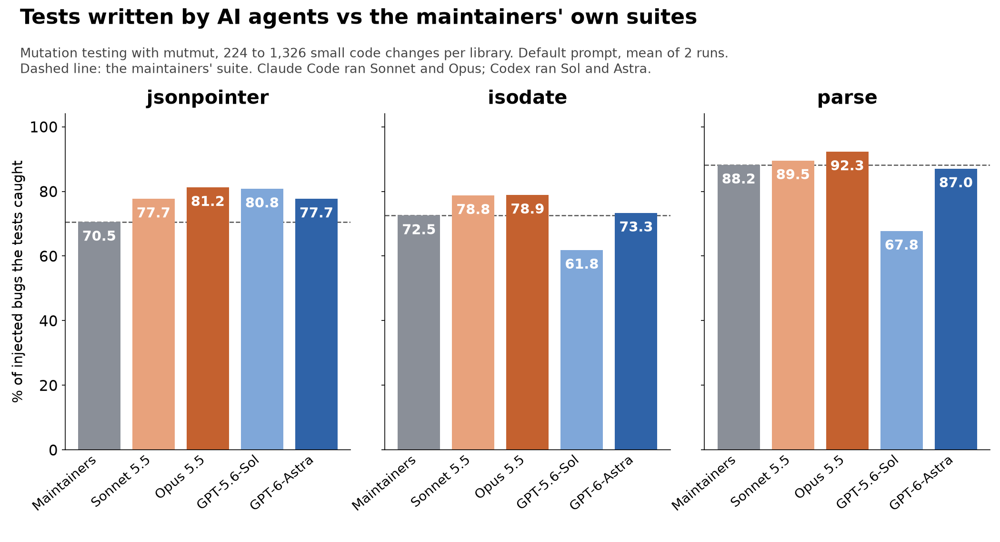

# agent-tests-mutation

Do test suites written by AI coding agents catch bugs? Claude Code (Sonnet 5.5, Opus 5.5) and
Codex (GPT-5.6-Sol, GPT-6-Astra) each wrote a pytest suite for three Python libraries with their
tests removed. Every suite, and the maintainers' own suite, was scored with mutmut 3.8.0 against
the same mutants, and each agent was also given the library with one planted, spec-violating bug.
Companion to *Claude Code's Tests Caught More Bugs Than the Maintainers' Own*.



## Results

```
Mutants killed (%), default prompt, mean of 2 runs per agent

                      jsonpointer  isodate    parse  line cov
--------------------  -----------  -------  -------  --------
Maintainers' tests           70.5     72.5     88.2    94-96%
Claude Sonnet 5.5            77.7     78.8     89.5    97-98%
Claude Opus 5.5              81.2     78.9     92.3       98%
Codex GPT-5.6-Sol            80.8     61.8     67.8    83-95%
Codex GPT-6-Astra            77.7     73.3     87.0    93-98%
Mutants per library           224     1326     1288
```

```
Mutants killed (%) by prompt and setup, mean of 2 runs

                        jsonpointer       isodate         parse
                         A   B   C     A   B   C     A   B   C
--------------------   ------------  ------------  ------------
Claude Sonnet 5.5       78  78  90    79  79  83    90  92  97
Claude Opus 5.5         81  94  95    79  82  90    92  94  98
Codex GPT-5.6-Sol       81  85  88    62  66  73    68  78* 82
Codex GPT-6-Astra       78  79  89    73  74* 84    87  88* 93
A  default prompt, no mutation-testing config in the repo
B  default prompt, mutmut configured in pyproject.toml
C  prompt says the suite will be judged by mutation testing
*  one run (the second hit Codex's usage limit)
```

```
Mutants killed (%), default prompt, under three definitions

                         all  no msg    all  no msg no cache
                         jsonpointer                 isodate
--------------------   -----  ------  -----  ------ --------
Maintainers' tests      70.5    81.6   72.5    73.8     82.4
Claude Sonnet 5.5       77.7    90.0   78.8    80.2     89.4
Claude Opus 5.5         81.2    92.7   78.9    80.4     89.8
Codex GPT-5.6-Sol       80.8    90.0   61.8    62.7     70.3
Codex GPT-6-Astra       77.7    90.3   73.3    74.7     83.4
no msg: excluding mutants that only change an error message's text
no cache: excluding regex-builder mutants hidden by isodate's cache
```

```
Planted bugs: what each agent's suite did (one letter per run)

                  maint.  Sonnet    Opus     Sol   Astra
----------------  ------  ------  ------  ------  ------
jp-unescape            -      FF      XF       X       X
jp-leading-zero        F      FF      FF       -       X
iso-tz-sign            F      FF      FF       F       X
iso-ordinal            F      FF      FF       X       X
parse-case             F      EX      FF       -       -
parse-percent          F      FX      FX       X       X
F  a test fails on the bug and the suite is left failing
X  a test asserts the right behaviour, marked expected-to-fail
E  a test asserts the buggy behaviour as correct
-  no test notices the bug
```

```
Cost and time per suite, default prompt (mean over 6 runs)

                       minutes  tests  test lines    cost
--------------------   -------  -----  ----------  ------
Claude Sonnet 5.5          1.9    188         807   $0.41
Claude Opus 5.5            3.0    317        1026   $0.81
Codex GPT-5.6-Sol          1.4     43         212    plan
Codex GPT-6-Astra          2.0    134         290    plan
```

## Layout

```
harness/fetch_libs.sh       clone jsonpointer, isodate and parse at the measured commits
harness/workspace.py        build a workspace: library source, no tests, optional planted bug
harness/run_agents.py       the prompts and agent invocations; resumable (--clean = condition A)
harness/run_bugs.py         the planted-bug runs
harness/bugs.py             the six planted bugs
harness/score.py            copy a suite into a pristine build, check it passes, coverage, mutmut
harness/classify.py         label mutants as error-message / string / logic
harness/audit.py            network commands and overlap with the maintainers' tests
harness/analyze.py          results/summary.json
harness/bug_score.py        classify planted-bug tests with --runxfail on buggy and correct code
harness/tables.py           results/tables.txt (the tables in the article)
harness/charts.py           the results chart
harness/export.py           copy everything below into results/, with local paths scrubbed
results/suites/             every agent-written suite, one folder per run
results/planted_bug_suites/ every suite from the planted-bug runs
results/scores/*.json       per-suite pass/fail, coverage and the status of every mutant
results/agent_runs/*.json   one record per agent run (time, cost or tokens, files changed)
results/bug_runs/*.json     one record per planted-bug run, with the agent's final message
results/logs/, bug_logs/    raw agent transcripts (Claude JSON / stream-json, Codex --json)
results/final_messages.json each run's closing summary
results/mutant_kinds.json   mutant classification used for the "no msg" column
```

Run names are `<agent>-<model>-<library>-<condition>-r<rep>`: `plainclean` is condition A,
`plain` is B, `mutation` is C. Human baselines are `human-<library>`.

## Reproduce

```
sh harness/fetch_libs.sh
uv venv .venv && uv pip install --python .venv/bin/python mutmut==3.8.0 pytest coverage matplotlib
python harness/run_agents.py /tmp/atm --reps 2 --jobs 3 --prompts plain --clean   # condition A
python harness/run_agents.py /tmp/atm --reps 2 --jobs 3 --prompts plain,mutation  # B and C
python harness/run_bugs.py /tmp/atm --reps 2 --jobs 3
python harness/score.py /tmp/atm && python harness/score.py /tmp/atm --human
python harness/classify.py /tmp/atm && python harness/audit.py /tmp/atm
python harness/analyze.py /tmp/atm && python harness/bug_score.py /tmp/atm
python harness/tables.py && python harness/charts.py results/01-results.png
```

Needs the `claude` and `codex` CLIs, logged in. Agents: Claude Code 2.1.292, Codex CLI 0.154.0,
both headless with user settings disabled. Libraries: jsonpointer 3.2.1 (f2641f0), isodate at
17cb25e (2024-10-09), parse 1.22.3 (0d2d28f). Run date 11 October 2026.

Caveats: isodate caches its compiled regexes at module level, so mutmut never exercises 161
regex-builder mutants (the "no cache" column excludes them). The jsonpointer maintainers'
command-line tests run a subprocess mutmut cannot trace and are excluded. Codex ran one rep of
each planted bug, and three condition-B Codex cells have one run because the second hit the
plan's usage limit.

MIT licensed. The three libraries are not included; `fetch_libs.sh` clones them.
